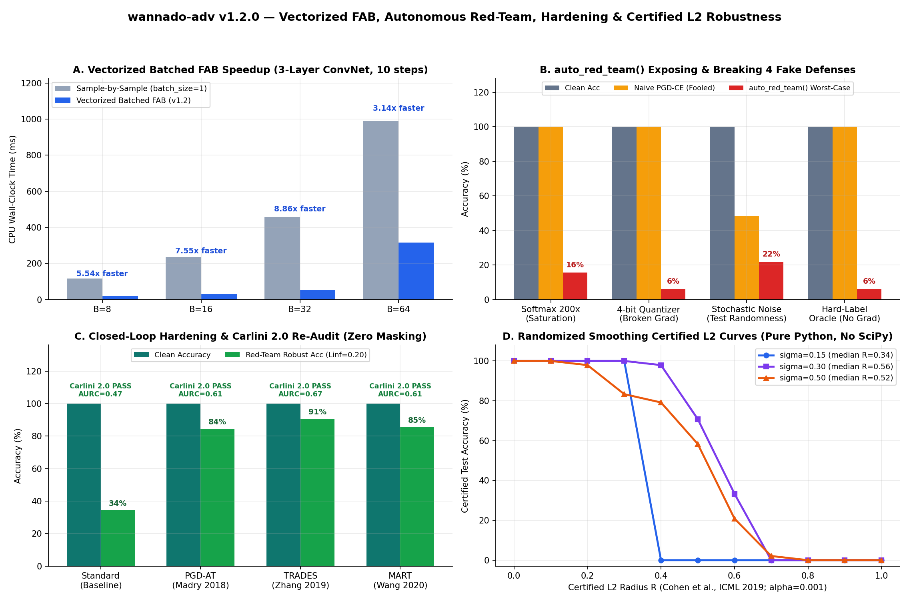

# WannaDo Series: Autonomous AI Red-Teaming, Hardening & Certification Platform — `wannado-adv`

> Part of the **WannaDo** human–AI collaborative scientific research platform · **Release `v1.2.2`**

[](pyproject.toml)
[](pyproject.toml)
[](#quick-usage-python--cli)
[](#quick-usage-python--cli)
[](LICENSE)

*"Hand your model to an AI agent for a complete, anti-fake-robustness red-team audit, hardening loop, and publication-ready dossier — in one command."*

`wannado-adv` is an **AI-native adversarial robustness platform** (`numpy` + `torch` only — **zero SciPy**) built around four core moats:

1. **One-Click Autonomous Red-Teaming & Carlini 2.0 Verify Gate**: `auto_red_team()` and `wannado-adv verify` diagnose Softmax saturation, non-differentiable `defense_fn` preprocessing, test-time stochasticity, and hard-label-only oracles automatically — escalating matched attacks (`apgd_dlr`, `bpda_eot` + `square_attack`, `eot_pgd`, `hopskipjump`, `apgd_l1`), reporting true per-sample worst-case ensemble survival with **Wilson 95% confidence intervals** and **`AURC` / `eps_50`** decay curves, and returning hard CI/agent exit codes (`0` PASS / `1` FAIL).
2. **Closed-Loop Single-File Hardening & Zero-SciPy L2 Certification**: Four standalone single-file defenses under `wannado.adv.defenses` — `pgd_adversarial_train` (Madry 2018), `trades_train` (Zhang 2019), `mart_train` (Wang 2020), and `certify_randomized_smoothing` (Cohen 2019, pure-Python Acklam inverse normal CDF + exact regularized incomplete beta Clopper–Pearson bounds) — designed to pair directly with Carlini 2.0 post-hardening re-audits so gradient masking cannot masquerade as robustness.
3. **CleanRL-Style Single-File Modularity & Isolated Boundary**: All 35 attacks and 4 defenses live in transparent single `.py` files and plug into any project through ONE non-intrusive adapter (`adv_eval/interface.py` via `VictimInterface` with `DataLoader` / `batch_size` / `defense_fn` support). Need to adapt a new paper? `wannado-adv eject <attack_or_defense_id>` extracts that single file cleanly.
4. **Hardwired Literature Provenance & Zero Citation Hallucination**: Verified paper metadata, BibTeX/IEEE/APA citations, and baseline-to-SOTA lineage live directly inside `META` + `registry.json` (`wannado-adv cite <ids>`), eliminating fabricated references across long agentic workflows.

> Domain-agnostic by design: supports standard `[0, 1]` vision models alongside native `torch.complex64` wireless baseband signals (`norm="jsr_db"`), tabular (per-feature bounds & immutable masks), time-series, continuous regression / DRL policies, and HuggingFace `ModelOutput` models.

## Installation

```bash
pip install wannado-adv
```

> **Independent Products, Optional Clean Coexistence**: `wannado-adv`, `wannado-drl`, and `wannado-wce` are completely independent packages. If `wannado-drl` is installed alongside `wannado-adv`, their namespaces (`wannado.adv` vs `wannado.drl`), skills (`.agents/skills/wannado-adv/` vs `.agents/skills/wannado-drl/`), and marked rule blocks (`<!-- wannado-adv:start/end -->`) are strictly isolated so AI agents never collide.

<details>
<summary>Development setup (editable install from source)</summary>

```bash
git clone https://github.com/JietaoZhao/wannado-adv.git
cd wannado-adv
pip install -e ".[dev]" --no-build-isolation
```

</details>

## Next Step: Launch One-Click Autonomous AI Red-Teaming

Built on the **cross-IDE open `AGENTS.md` + `.agents/skills/` standard** (works across **Cursor, Antigravity, VS Code Codex, Claude Code, Windsurf, Aider**, and other coding agents). Inside **your own ML project root**:

### Step 1 — Bind Universal `wannado-adv` Agent Rules (one-time)

```bash
wannado-adv init-agent --dir .
```

This writes `AGENTS.md` + `.agents/skills/wannado-adv/SKILL.md` plus discovery adapters for **Cursor** (`.cursor/rules/wannado-adv.mdc`), **Antigravity** (`.agent/skills/`), and **Claude Code** (`CLAUDE.md`, `.claude/skills/`) without touching your training code. *(Prefer only open-standard files? Pass `--ide universal`.)*

### Step 2 — Prompt Your AI IDE Agent

> **"Run a full autonomous adversarial red-team test on this project and harden the model if it fails."**

### What Happens Next (Autonomous Closed-Loop Flow)

1. **Inspect & Probe**: Runs `wannado-adv inspect .` (`scan_project` + `probe_model_context`) to infer domain, tensor dtype (`float32` vs `torch.complex64`), bounds, checkpoints, and gradient health.
2. **Isolate Boundary**: Scaffolds `./adv_eval/interface.py` (`wannado-adv scaffold`) wrapping your model, optional `defense_fn` / `surrogate_fn`, and `DataLoader` cleanly without modifying training scripts.
3. **One-Click Red-Team & Verify Gate**: Executes `wannado-adv verify --interface ./adv_eval/interface.py --goal standard` (`auto_red_team()` + Carlini 2.0), automatically bypassing fake defenses and exporting `red_team_report.json`, `red_team_summary.md`, `paper_table.tex`, `references.bib`, `robustness_curve.csv`, and `robustness_curve.png`.
4. **Closed-Loop Hardening & Carlini 2.0 Re-Audit**: If the gate fails, hardens with `trades_train` / `pgd_adversarial_train` / `mart_train` (or certifies L2 radii via `certify_randomized_smoothing`), then immediately re-runs `wannado-adv verify` to confirm genuine robustness (`passed=True`).

## Quick Usage (Python & CLI)

```python
from wannado.adv import (
    auto_red_team,
    certify_randomized_smoothing,
    gaussian_augmented_train,
    pgd,
    trades_train,
)

# 1. One-click autonomous red-team (supports DataLoader, defense_fn, regression/DRL, complex64 IQ)
rt = auto_red_team(model, test_loader, eps=8/255, norm="linf", clip_bounds=(0.0, 1.0))
rt.save("./adv_eval/outputs")  # JSON, Markdown, LaTeX, BibTeX, AURC/eps_50 curve CSV & PNG

# 2. Closed-loop hardening (PGD-AT / TRADES / MART) + Carlini 2.0 re-audit
trades_train(model, train_loader, eps=8/255, beta=6.0, norm="linf", clip_bounds=(0.0, 1.0))
rt_after = auto_red_team(model, test_loader, eps=8/255, norm="linf", clip_bounds=(0.0, 1.0))

# 3. Provable L2 certification via Randomized Smoothing (pure Python — zero SciPy)
gaussian_augmented_train(model, train_loader, sigma=0.25, clip_bounds=(0.0, 1.0))
cert = certify_randomized_smoothing(model, x_test, y_test, sigma=0.25, n0=100, n=1000, alpha=0.001, clip_bounds=(0.0, 1.0))

# 4. Native torch.complex64 wireless baseband jamming under Jamming-to-Signal Ratio (-10 dB)
res_rf = pgd(wireless_rx, iq_signal, mod_labels, eps=-10.0, norm="jsr_db", steps=20)
```

<details>
<summary>Standalone CLI Commands &amp; Single-File Ejection</summary>

```bash
# Inspect project, list 35 attacks + 4 single-file defenses, and run hard verification gate
wannado-adv inspect .
wannado-adv arsenal
wannado-adv scaffold --dir ./adv_eval --domain vision
wannado-adv verify --interface ./adv_eval/interface.py --goal standard --samples 100 --min-robust-acc 0.60

# Eject ANY single-file attack or defense for custom new-paper prototyping
wannado-adv eject apgd_dlr --dest ./adv_eval/attacks
wannado-adv eject trades --dest ./adv_eval/defenses

# Export verbatim verified citations (attacks + defenses, zero hallucination)
wannado-adv cite fgsm pgd apgd_dlr trades mart randomized_smoothing --format bibtex --include-audit-ref
```

</details>

## Benchmarks & End-to-End Validation

End-to-end validation scripts live under [`benchmarks/`](https://github.com/JietaoZhao/wannado-adv/blob/main/benchmarks/README.md) (strictly decoupled from core `pyproject.toml` dependencies).

### 1. Vectorized `FAB`, Autonomous Red-Team Fake-Defense Suite, Hardening & Certified L2 Smoothing

- **Vectorized Batched `FAB` Speedup**: `3.14x–8.86x` CPU speedup (`B=8..64`, 3-layer ConvNet, 10 steps) via batched hyperplane projection + `batch_size` chunking.
- **Breaking 4 Classic Fake Defenses (`auto_red_team()`)**: Exposes and defeats **Softmax 200x** (naive PGD `100%` -> auto-escalated `apgd_dlr` `15.6%`), **4-bit Quantizer** (naive PGD `100%` -> `bpda_eot` + `square_attack` `6.2%`), **Stochastic Noise** (naive PGD `48.4%` -> `eot_pgd` `21.9%`), and **Hard-Label Oracle** (naive PGD `100%` -> `hopskipjump` `6.2%`).
- **Closed-Loop Hardening & Carlini 2.0 Re-Audit**: Raises worst-case red-team robust accuracy (`Linf=0.20`) from `34.4%` (Baseline, `AURC=0.47`) to `84.4%` (`PGD-AT`, `AURC=0.61`), `90.6%` (`TRADES`, `AURC=0.67`), and `85.4%` (`MART`, `AURC=0.61`) — all passing Carlini 2.0 (`passed=True`, zero gradient masking).
- **Zero-SciPy Randomized Smoothing Certification**: Pure-Python Clopper–Pearson L2 curves (`alpha=0.001`) achieve median certified radii up to `R = 0.56` (`sigma=0.30`).



### 2. Vision Parity (`RobustBench` / `torchattacks` / Official `AutoAttack`) & False-Robustness Audit

- **MPS Compatibility**: `26/26` representative Wave 1+2 attacks pass natively on Apple Silicon `mps`.
- **CIFAR-10 Parity (`eps=8/255`, `N=200`)**: Matches `torchattacks` & official `fra31/auto-attack` on `Standard` (Clean `94.5%`, `PGD-10`/`MI`/`NI`/`DI`/`APGD` -> `0.0%`, `AutoAttack` `0.0%` in `19.43s` vs `22.10s`) and aligns on `Wong2020Fast` (Clean `86.0%`, `FGSM 53.0%`, `PGD-10 46.0%`, `NI-FGSM 47.5% vs 51.0%`, `Square-500q 63.0% vs 65.5%`, `AutoAttack 42.0%` [5-stage including untargeted APGD-DLR] vs `43.0%` [official 4-stage]).
- **Carlini Trap Detection**: `audit_robustness()` automatically flags `softmax_saturation_masking` on logit-rescaled models (`10^3 x logits`: naive `PGD-CE` fooled at `85.0%`, bypassed by `apgd_dlr` at `49.0%`) and `broken_or_vanishing_gradients` on non-differentiable 4-bit input quantization (`torchattacks PGD` stalled at `85.0%`, bypassed by `bpda_eot` at `45.5%`).


### 3. Native `torch.complex64` Wireless Baseband (`norm="jsr_db"`)

- Tested across 6 modulation schemes (`BPSK`, `QPSK`, `8PSK`, `16QAM`, `64QAM`, `PAM4`, Clean Acc `83.33%`) using unified power-ratio constraints `JSR in [-24, 0] dB` with zero real/imag manual splitting.
- On a non-differentiable 4-bit IQ ADC receiver (`83.33%` clean), naive `PGD` reports `82.3%–83.3%` apparent robustness due to zero quantizer gradients; `audit_robustness()` immediately raises red flags, and `bpda_eot` reduces real accuracy monotonically to `42.7% (-24 dB) -> 18.8% (-18 dB) -> 1.0% (-14 dB) -> 0.0% (-10 dB)`.


## Running Tests & Rebuilding the Catalog

```bash
pytest -v
ruff check src tests benchmarks
mypy src/wannado/adv
python3 -m wannado.adv.catalog --build
```

## Feedback & Suggestions

Found a bug, want a new attack or defense paper implemented, or have ideas to improve the autonomous agent experience? Send feedback without leaving GitHub:

- **Open Feedback Portal**: [https://jietaozhao.github.io/wannado-adv/](https://jietaozhao.github.io/wannado-adv/)
- Or scan the QR code below from your phone:

<a href="https://jietaozhao.github.io/wannado-adv/">
  
</a>
