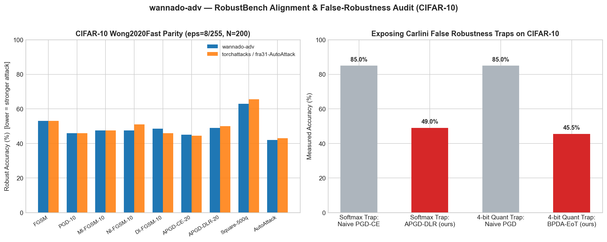
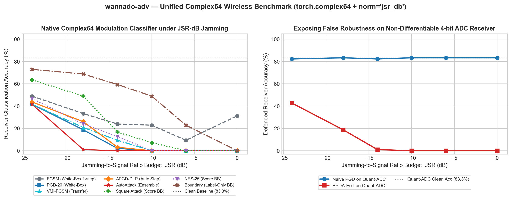

# WannaDo Series: Automated AI-Collaboration Platform for Adversarial Learning — `wannado-adv`

> Part of the **WannaDo** human–AI collaborative scientific research platform · **Release `v1.0.3`**

*"Wanna do an adversarial robustness test on any of your machine learning projects?"*

`wannado-adv` is an **AI-focused adversarial learning platform** built around three core moats:

1. **AI-Focused & Co-Pilot Native**: Designed from the ground up for AI IDE agents, with structured collaboration prompts, `AGENTS.md` / `SKILL.md` protocols, and inline engineering notes baked directly into the library. Instead of improvising ad-hoc attack scripts, your AI agent follows built-in guardrails to inspect your project, explain parameters in zero-jargon plain language, forecast hardware runtime ETA, audit for false robustness, and export paper-ready experimental summaries.
2. **Modular Single-File Architecture & Isolated Interface**: Every attack algorithm lives in one transparent, self-contained single `.py` file and plugs into your project through a single non-intrusive evaluation boundary (`adv_eval/interface.py` via `VictimInterface`)—never polluting your core training or model files. You can see at a glance where each algorithm resides and how it runs; when adapting an idea from a new paper, simply `eject` and optimize that single standalone file while keeping maintenance effortless.
3. **Hardwired Literature Alignment & Zero Citation Hallucination**: Every attack's verified paper metadata, BibTeX/IEEE/APA citations, baseline-to-SOTA lineage, and intuition notes are hardcoded directly inside the library (`META` + compiled `registry.json`). Both users and AI agents select verified implementations straight from the built-in catalog without relying on live web search—eliminating citation hallucinations and paper-to-code mismatches across long agentic tasks.

> Domain-agnostic by design: supports standard `[0, 1]` vision models alongside native `torch.complex64` wireless baseband signals (`jsr_db`), tabular, time-series, unsupervised losses, and DRL policies through the same clean interface.

## Installation

```bash
pip install wannado-adv
```

> **Optional Two-Stage Ecosystem Workflow (`wannado-drl` + `wannado-adv`)**: Both packages remain 100% independent—you never need `wannado-drl` to use `wannado-adv`, and vice versa. When installed side-by-side (e.g., training a policy with `wannado-drl` in `./drl_lab/` before auditing its perturbation robustness with `wannado-adv` in `./adv_eval/`), their namespaces (`wannado.adv` / `wannado.drl`), skills (`.agents/skills/wannado-adv/` vs `.agents/skills/wannado-drl/`), and marked rule blocks (`<!-- wannado-adv:start/end -->` vs `<!-- wannado-drl:start/end -->`) are strictly isolated with explicit intent boundaries so their AI Co-Pilot prompts never overwrite or conflict with one another.

<details>
<summary>Development setup (editable install from source)</summary>

```bash
git clone https://github.com/JietaoZhao/wannado-adv.git
cd wannado-adv
pip install -e ".[dev]" --no-build-isolation
```

</details>

## Next Step: Launch the Universal AI IDE Co-Pilot

Built on the **cross-IDE open `AGENTS.md` + `.agents/skills/` standard** (works across **Cursor, Antigravity, VS Code Codex, Claude Code, Windsurf, Aider**, and future AI IDEs). Once `pip install wannado-adv` completes, follow these two steps inside **your own ML project root**:

### Step 1 — Bind Universal `wannado-adv` Co-Pilot Rules (one-time)

```bash
wannado-adv init-agent --dir .
```

This writes the **open-standard `AGENTS.md` + `.agents/skills/wannado-adv/SKILL.md`** plus lightweight discovery adapters for **Cursor** (`.cursor/rules/wannado-adv.mdc`), **Antigravity** (`.agent/skills/`), **Claude Code** (`CLAUDE.md`, `.claude/skills/`), **VS Code + Codex**, **Windsurf**, etc., without modifying any of your training or model code.  
*(Prefer only open-standard files with no IDE-specific folders? Pass `--ide universal`.)*

### Step 2 — Prompt Your AI IDE Agent

Open the AI chat in any AI IDE and say:

> **"Do an adversarial learning robustness test on this project..."**

*(Even if you skipped Step 1 in a brand-new IDE, simply tell the agent: `"Initialize wannado-adv agent rules first (wannado-adv init-agent --dir .), then do an adversarial learning robustness test on this project."`)*

### What Happens Next (Automated 4-Phase Co-Pilot Flow)

1. **Traverse & Probe**: The agent runs `wannado-adv inspect .` (`scan_project` + `probe_model_context`) to inspect your repo structure, framework, tensor shape/dtype (`float32` vs `torch.complex64`), SOTA attack lineage, and gradient health.
2. **Zero-Jargon Clarification & Runtime ETA**: Before heavy runs, the agent replies in **your conversation language**, explains every knob with **plain everyday analogies and small-vs-large trade-offs** (`eps` / `jsr_db`, `steps`, test scale `N`), keeps academic terms in parentheses for reference, ensures every choice explains its practical effect, and gives a live hardware forecast (`estimate_runtime()`).
3. **Non-Intrusive Boundary & Single-File Algorithms**: It creates an isolated `adv_eval/` workspace (`wannado-adv scaffold`) via `VictimInterface` so your project stays clean. Want to adapt one paper's idea? Run `wannado-adv eject pgd` to extract that attack into a standalone editable `.py` file.
4. **Carlini Audit & Paper-Ready Exports**: Opens with a clear plain-language takeaway, checks for fake robustness via `audit_robustness()` (gradient masking / softmax saturation), and exports `evaluation_report.json`, `paper_summary.md`, `paper_table.tex` (`booktabs`), and verified `references.bib` (zero citation hallucination).

## Quick Usage (Python & CLI)

```python
from wannado.adv import fgsm, pgd, autoattack, preflight, audit_robustness, query_catalog

# 1. AI-native preflight check & Carlini-style robustness audit
report = preflight(model, x, y, attack="pgd", eps=0.03, norm="linf", clip_bounds=(0.0, 1.0))
audit = audit_robustness(model, x, y, eps=0.03, norm="linf", clip_bounds=(0.0, 1.0))

# 2. Standard vision or AutoAttack ensemble
res_fgsm = fgsm(model, x, y, eps=0.03, norm="linf", clip_bounds=(0.0, 1.0))
res_aa = autoattack(model, x, y, eps=0.03, norm="linf", clip_bounds=(0.0, 1.0))

# 3. Wireless communication complex IQ signal with Jamming-to-Signal Ratio (-10 dB)
res_pgd = pgd(wireless_rx, iq_signal, mod_labels, eps=-10.0, norm="jsr_db", steps=20)

# 4. Query the algorithm knowledge graph
cards = query_catalog(family="first_order", tier="S")
```

<details>
<summary>Standalone Co-Pilot CLI &amp; End-to-End Reporting Python API</summary>

```bash
# Traverse your project, detect domain & SOTA lineage, and print parameter guides
wannado-adv inspect .

# Scaffold ONE non-intrusive evaluation boundary (adv_eval/interface.py + adv_eval/run_eval.py)
wannado-adv scaffold --dir ./adv_eval --domain wireless

# Customize ONE attack from a new paper without touching your project or other attacks
wannado-adv eject fgsm --dest ./adv_eval/attacks

# Export verbatim verified citations (zero LLM/web hallucination)
wannado-adv cite fgsm pgd apgd_dlr --format bibtex --include-audit-ref
```

```python
from wannado.adv import scan_project, probe_model_context, recommend_suite, estimate_runtime, evaluate_suite

scan = scan_project(".")
probe = probe_model_context(model, x_eval, y_eval)
suite = recommend_suite(domain=probe.inferred_domain, goal="standard", autograd_ok=probe.autograd_connected)
print(estimate_runtime(model, x_eval, suite, num_samples=len(x_eval)).format_summary())

report = evaluate_suite(
    model, x_eval, y_eval,
    eps=-10.0 if probe.is_complex else 8/255,
    norm=probe.recommended_norm,
    attacks=suite.attacks,
    attack_kwargs=suite.attack_kwargs,
    clip_bounds=probe.recommended_clip_bounds,
    model_name="MyModel",
    dataset_name="TestSplit",
)
report.save("./adv_eval/outputs")  # evaluation_report.json, paper_summary.md, paper_table.tex, references.bib
```

</details>

## Benchmarks & End-to-End Validation

End-to-end validation scripts live under [`benchmarks/`](https://github.com/JietaoZhao/wannado-adv/blob/main/benchmarks/README.md) (kept strictly decoupled from core `pyproject.toml` dependencies). All numbers below are measured on Apple Silicon (`mps` for vision, `cpu` for native `torch.complex64` baseband RF).

### 1. Vision Parity (`RobustBench` / `torchattacks` / Official `AutoAttack`) & False-Robustness Audit

- **MPS Compatibility**: `26/26` representative Wave 1+2 attacks pass natively on Apple Silicon `mps`.
- **CIFAR-10 Parity (`eps=8/255`, `N=200`)**: Matches `torchattacks` & official `fra31/auto-attack` on `Standard` (Clean `94.5%`, `PGD-10`/`MI`/`NI`/`DI`/`APGD` -> `0.0%`, `AutoAttack` `0.0%` in `19.43s` vs `22.10s`) and matches/tightens `Wong2020Fast` (Clean `86.0%`, `FGSM 53.0%`, `PGD-10 46.0%`, `NI-FGSM 47.5% vs 51.0%`, `Square-500q 63.0% vs 65.5%`, `AutoAttack 42.0% vs 43.0%`).
- **Carlini Trap Detection**: `audit_robustness()` automatically flags `softmax_saturation_masking` on logit-rescaled models (`10^3 x logits`: naive `PGD-CE` fooled at `85.0%`, bypassed by `apgd_dlr` at `49.0%`) and `broken_or_vanishing_gradients` on non-differentiable 4-bit input quantization (`torchattacks PGD` stalled at `85.0%`, bypassed by `bpda_eot` at `45.5%`).



### 2. Native `torch.complex64` Wireless Baseband (`norm="jsr_db"`)

- Tested across 6 modulation schemes (`BPSK`, `QPSK`, `8PSK`, `16QAM`, `64QAM`, `PAM4`, Clean Acc `83.33%`) using unified power-ratio constraints `JSR in [-24, 0] dB` with zero real/imag manual splitting.
- On a non-differentiable 4-bit IQ ADC receiver (`83.33%` clean), naive `PGD` reports `82.3%–83.3%` apparent robustness due to zero quantizer gradients; `audit_robustness()` immediately raises red flags, and `bpda_eot` reduces real accuracy monotonically to `42.7% (-24 dB) -> 18.8% (-18 dB) -> 1.0% (-14 dB) -> 0.0% (-10 dB)`.



## Running Tests & Rebuilding the Catalog

```bash
python3 -m unittest discover -s tests -v
python3 -m wannado.adv.catalog --build
```

## Feedback & Suggestions

Found a bug, want a new attack paper implemented, or have ideas to improve the AI IDE Co-Pilot experience? Send feedback or suggestions without leaving GitHub:

- **Open Feedback Portal**: [https://jietaozhao.github.io/wannado-adv/](https://jietaozhao.github.io/wannado-adv/)
- Or scan the QR code below from your phone:

<a href="https://jietaozhao.github.io/wannado-adv/">
  
</a>
